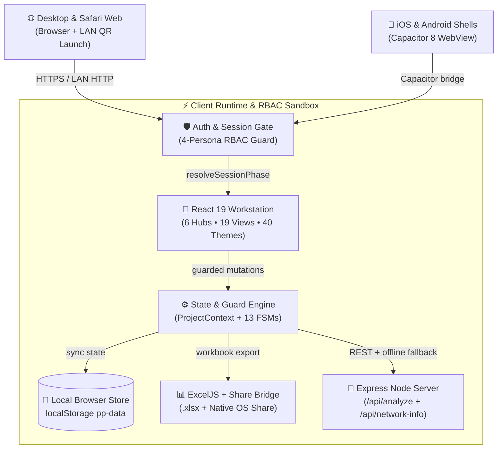
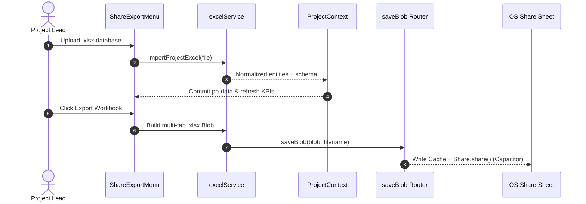
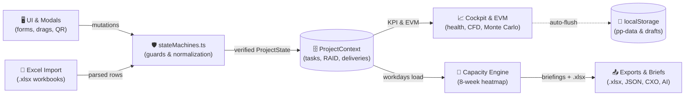
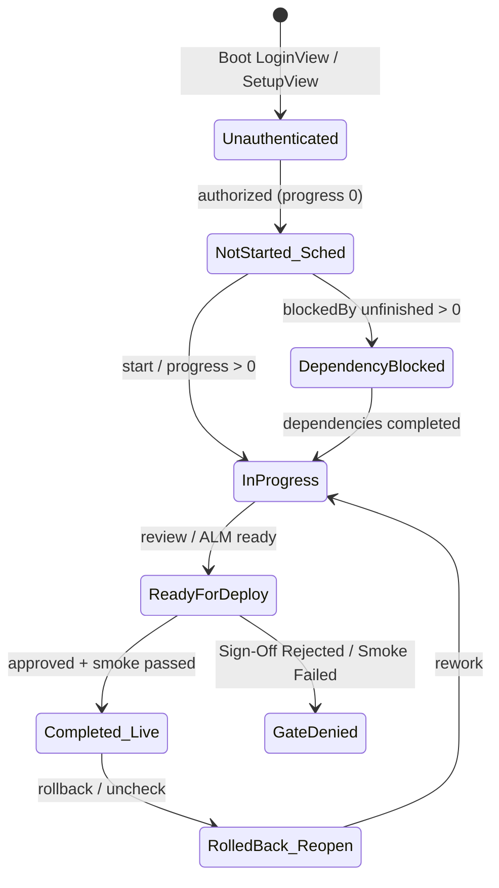

# ProjectPulse 2.0 — Architecture & System Design

> **Executive Overview**: Componentized, local-first project governance and ALM workstation built with React 19, TypeScript, Tailwind CSS v4, Express (`/api/analyze` & `/api/network-info`), ExcelJS 4.4, and Capacitor 8. Operates offline via `localStorage` (`pp-data`), enforces 13 explicit finite state machines (`src/utils/stateMachines.ts`), supports 4 RBAC personas and 40 themes, and ships across Web, Mobile Safari QR, iOS, and Android.

All five core system diagrams match the compiled interactive specs in [`docs/diagrams/`](../docs/diagrams/) and are documented in full inside [`ProjectPulse_2.0_Product_Capability_and_Specification_Manual.docx`](../docs/ProjectPulse_2.0_Product_Capability_and_Specification_Manual.docx).

---

## 🏛️ 1. System Architecture

### Component Responsibilities
* **Auth & Session Gate (`src/store/AuthContext.tsx`)**: Computes deterministic session phase (`unauthenticated -> onboarding -> denied | authorized`) across Admin, Project Manager, Developer, and Stakeholder roles.
* **React 19 Workstation**: 6 Journey Hubs, 19 Screen Modules, collapsible KPI summary strips, interactive SVG/Gantt canvases, and 40 curated WCAG-contrast-checked themes (`ThemeGrid.tsx`).
* **Express Server (`server.ts`)**: Optional Node backend serving `POST /api/analyze` (Gemini `gemini-3-flash-preview` with client offline fallback) and `GET /api/network-info` (LAN IPv4 discovery for the Desktop-to-Safari QR Launcher).

---

## 🔄 2. Governance & Delivery Workflow

```mermaid
flowchart LR
    Auth["🔐 RBAC Sign-In\n(4 roles + overrides)"] --> Setup["🧭 Workspace Init\n(blank / demo / .xlsx)"]
    Setup --> Scaffold["📐 Scaffolder & Matrix\n(releases, WBS, fields)"]
    Scaffold -->|"generate WBS"| Tasks["📋 Tasks & Gantt\n(grid, board & blockers)"]
    Tasks -->|"linked items"| QA["🧪 Defects & RAID\n(triage & sign-off log)"]
    QA -->|"resolved scope"| Deliver["🚦 ALM Deploy Gate\n(smoke + approval check)"]
    Deliver -->|"PDN & reports"| Export["📦 ExcelJS & Briefs\n(multi-tab .xlsx, CXO & OS Share)"]
```

---

## ⚡ 3. ExcelJS Sync & Native Share Sequence

---

## 🌊 4. Reactive Data Flow Pipeline

---

## ⏱️ 5. Entity & Gate Lifecycle State Machine

