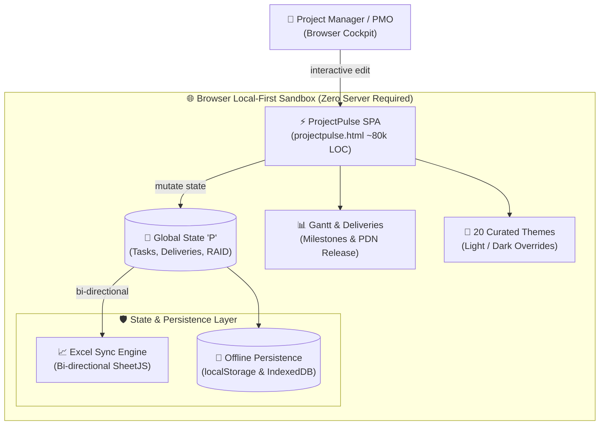
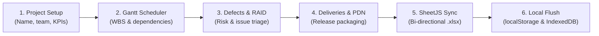
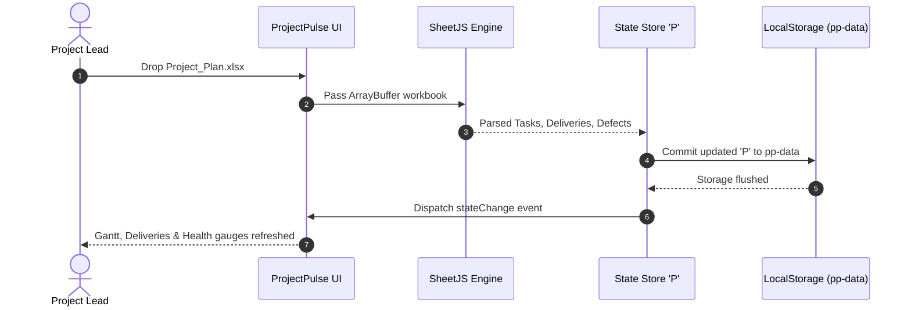
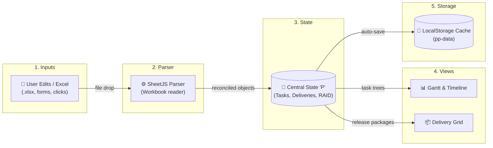
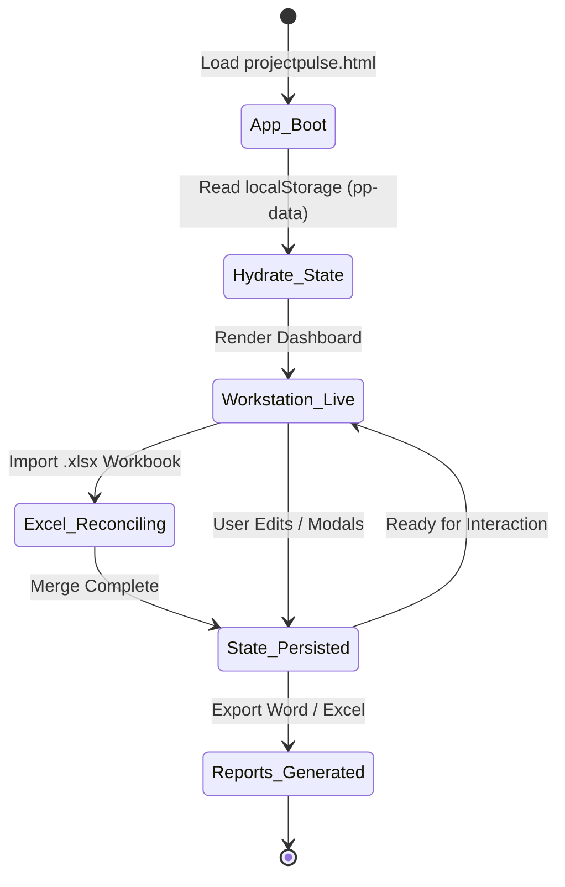

# ProjectPulse — Architecture & System Design

> **Executive Overview**: Monolithic, local-first project management workstation built in pure Vanilla HTML5/JS/CSS (~80,800 LOC). Operates entirely within the browser client sandbox with zero server dependencies, sub-millisecond in-memory reactivity, bi-directional SheetJS Excel synchronization, and offline durability.

All system architectures, governance workflows, synchronization sequences, data pipelines, and workstation lifecycles are embedded below as native Mermaid diagrams with full architectural explanations.

---

## 🏛️ 1. System Architecture

### Architectural Breakdown & Component Responsibilities
* **Browser Local-First Sandbox**: ProjectPulse executes entirely within the browser's JavaScript V8/SpiderMonkey runtime. Because no remote application server or database is required, enterprise users operate in an air-gapped, zero-leak environment compliant with strict data residency regulations.
* **ProjectPulse Monolithic SPA (`projectpulse.html`)**: A unified, high-density workstation combining UI layout, mathematical scheduling engines, SVG renderers, and event dispatchers in a clean, buildless distribution.
* **Global Reactive State Store (`P`)**: A single source of truth object tree in memory containing active project metadata, WBS task hierarchies, team capacity matrices, RAID registers, and governance notes.
* **Gantt & Delivery Scheduler**: High-performance SVG canvas rendering task timelines, dependency links (Finish-to-Start, Start-to-Start), critical path flags, and milestone markers with zero external charting libraries.
* **State & Persistence Subsystems**:
  * **Bi-directional SheetJS Reconciler**: Ingests and generates standard multi-sheet `.xlsx` workbooks, mapping cell grids to typed JavaScript objects without loss of formulas or custom columns.
  * **LocalStorage & IndexedDB Storage (`pp-data`)**: Dual-engine persistence layer that automatically snapshots the `P` state on every mutation with debounce throttling (300ms) to ensure zero data loss on browser refresh.

---

## 🔄 2. Project Governance & Delivery Workflow

### Operational Workflow Stages
1. **Project Scaffolding & Calibration**: Initializes project parameters, budget caps, delivery calendars, and team resource availability rosters.
2. **WBS & Critical Path Scheduling**: Tasks are mapped with durations, baselines, and parent-child hierarchies. The engine dynamically computes critical paths and slack times.
3. **Defects & RAID Matrix Triage**: Evaluates project risk impact vs. probability, logs active blockers, assigns mitigations, and tracks software defect severities.
4. **Deliveries & Project Delivery Notes (PDN)**: Batches completed tasks and acceptance criteria into formalized release milestones, generating executive release documentation.
5. **SheetJS Bi-directional Reconciler**: Reconciles external changes from PMO spreadsheets against current browser state, resolving field conflicts using timestamped delta priority.
6. **Persistence & Local Flush**: Serializes reconciled trees into compressed browser storage chunks, updating cache indices and dispatching status events.

---

## ⚡ 3. Bi-directional Excel Sync Sequence

### Execution Sequence Details
* **Step 1–2 (File Ingestion & Binary Array Parsing)**: Dragging an Excel file over the browser viewport triggers a native `DragEvent`. The file's binary stream is read via `FileReader.readAsArrayBuffer()` and delivered to the embedded SheetJS parser.
* **Step 3 (Schema Sniffing & In-Memory Entity Mapping)**: SheetJS inspects sheet names (`Tasks`, `RAID`, `Deliveries`), mapping tabular columns into typed JSON models with schema fallback heuristics for missing fields.
* **Step 4–5 (Atomic State Commit & Storage Write)**: The central state `P` merges imported entities. An atomic commit is executed to `localStorage['pp-data']`. If storage limits are approached, secondary large payload trees roll over to IndexedDB.
* **Step 6–7 (Reactive Event Dispatch & 60 FPS Re-render)**: A custom `stateChange` synthetic event triggers DOM sub-tree updates, updating the Gantt timeline, progress meters, and RAID matrix simultaneously.

---

## 🌊 4. Project Data Flow Pipeline

### Data Pipeline Mechanics & Invariants
* **Input Layer**: Handles both direct DOM micro-edits (inline editing of task name, date pickers, drag handles) and macro file drops (.xlsx).
* **Parser Layer**: Sanitizes input strings, validates ISO date formats, normalizes percentages, and prevents XSS by escaping HTML entities.
* **Central State**: Manages memory layout. Immutable clone snapshots are stored in a ring buffer to provide multi-step Undo/Redo capabilities.
* **View Layer**: Implements virtualized DOM rendering for task lists and pure SVG path construction for Gantt dependency curves.
* **Storage Layer**: Guarantees zero data loss across browser tabs using the StorageEvent API to synchronize state changes across multiple open windows.

---

## ⏱️ 5. Workstation Session Lifecycle

### Lifecycle State Machine Rules
* **`App_Boot`**: HTML document loads, stylesheets initialize theme variables, and global namespace `window.P` is verified.
* **`Hydrate_State`**: Queries `localStorage.getItem('pp-data')`. If valid JSON exists, it hydrates the working state; if empty, it initializes the project template.
* **`Workstation_Live`**: Interactive operational state. Event listeners handle keyboard shortcuts, drag-and-drop operations, and modal views.
* **`Excel_Reconciling`**: Asynchronous modal state during large workbook parsing to prevent thread blocking.
* **`State_Persisted`**: Transitory checkpoint reached after debounced serialization, ensuring all modifications are durably saved.
* **`Reports_Generated`**: Packaging state where Word (`.docx`), Excel (`.xlsx`), or PDF delivery documents are compiled and triggered for browser download.
